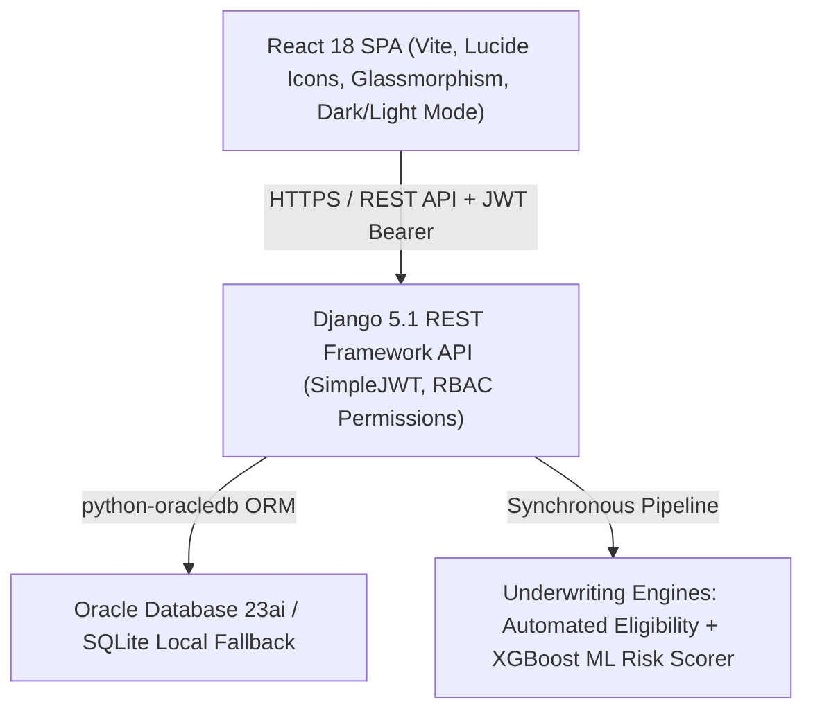

# LoanPulse — End-to-End Digital Lending & Loan Lifecycle Management Platform

[](Jenkinsfile)
[](backend/)
[](frontend/)
[](docker-compose.yml)
[](docs/openapi.yaml)
[](tests/)

> **"Powering Smarter Lending."**  
> *From Application to Closure — Every Loan, One Platform.*

---

## 1. Executive Summary

**LoanPulse** is an enterprise-grade, full-stack digital lending and loan lifecycle management platform designed for banks, non-banking financial companies (NBFCs), and fintech lenders. 

Unlike basic CRUD templates, LoanPulse implements strict **financial-grade business logic, automated risk underwriting, delegation of financial powers (DoFP), amortized EMI schedule generation, simulated payment gateway integration, delinquency management, in-app notifications, and forensic audit logging**.

---

## 2. Technology Architecture



### Stack Details
* **Frontend:** React 18, Vite, Vanilla CSS with custom design tokens, Lucide Icons, Canvas Confetti.
* **Backend:** Python 3.13, Django 5.1, Django REST Framework, Django-Cors-Headers, SimpleJWT, drf-spectacular.
* **Database:** Native **Oracle Database** via `python-oracledb` (with auto-fallback to SQLite for zero-setup local execution).
* **Testing:** Pytest, pytest-django.
* **DevOps & CI/CD:** Docker multi-stage builds, Docker Compose, Jenkins declarative pipeline.
* **API Documentation:** Swagger UI (`/api/docs/`), Redoc (`/api/redoc/`), and OpenAPI 3.0 YAML (`/api/schema/`).

---

## 3. Pre-Seeded Demo Personas (1-Click Switcher)

LoanPulse includes a floating top banner in the frontend allowing instant 1-click authentication across all six roles:

| Role | Username / Email | Password | Primary Workspace / Dashboard |
| :--- | :--- | :--- | :--- |
| **Customer** | `customer@loanpulse.com` | `Pass@123` | Multi-step onboarding, KYC document upload, loan origination, EMI schedule, payment gateway, support tickets |
| **Loan Officer** | `officer@loanpulse.com` | `Pass@123` | Loan application triage, KYC document verification desk, remarks & info requests |
| **Risk Analyst** | `analyst@loanpulse.com` | `Pass@123` | Credit scoring workbench, XGBoost default probability ($PD$), risk band gauges, DTI radar |
| **Manager** | `manager@loanpulse.com` | `Pass@123` | Sanctions & approvals queue, RTGS fund disbursement desk, portfolio overview |
| **Collection Officer** | `collection@loanpulse.com` | `Pass@123` | Delinquent accounts (30+, 60+, 90+ DPD buckets), PTP recording, debtor call logs |
| **Admin** | `admin@loanpulse.com` | `Pass@123` | User & RBAC directory, loan products configuration, dynamic approval matrix limits, audit logs, CSV export |

---

## 4. End-to-End Loan Lifecycle Workflow

```
[ Customer Registration ]
         ↓
[ Step 1-4 KYC & Onboarding ] (Identity, Employment, Bank, Documents)
         ↓
[ Loan Origination & Product Selection ] (Personal, Home, Auto, Education)
         ↓
[ Automated Eligibility Engine ] (Income, FOIR/DTI ratio, Minimum credit score)
         ↓
[ Loan Application Submission ] (Unique ID generated, e.g., LP-2026-000123)
         ↓
[ KYC Document Verification Desk ] (Loan Officer approves/rejects files)
         ↓
[ ML Credit Risk Assessment ] (Default Probability PD %, Risk Tier, Scorecard)
         ↓
[ Multi-Tier Approval Matrix ] (DoFP: Tier 1 Officer ≤ ₹5L, Tier 2 Manager ≤ ₹20L, Tier 3 Senior Committee > ₹20L)
         ↓
[ Disbursement Execution Desk ] (Manager triggers simulated RTGS/NEFT transfer)
         ↓
[ Automated Amortization Schedule ] (Equated Monthly Installments: Principal, Interest, Balance)
         ↓
[ Interactive Payment Gateway ] (Card / NetBanking / UPI QR Code + Instant Digital Receipt)
         ↓
[ Delinquency & Overdue Management ] (Days Past Due DPD tracking, PTP follow-up)
         ↓
[ Full Loan Closure ] (Forensic Audit Trail & Certificate)
```

---

## 5. Directory Structure

```text
loanpulse/
├── backend/
│   ├── apps/
│   │   ├── authentication/     # Custom User model, JWT token claims, RBAC permissions
│   │   ├── audit/              # Immutable forensic audit logging
│   │   ├── customers/          # Customer profiles & bank details
│   │   ├── kyc/                # Document upload, MIME validation, verification desk
│   │   ├── loans/              # Loan products, applications, timeline, approval matrix, disbursements
│   │   ├── payments/           # EMI schedules, transactions, amortization generator
│   │   ├── risk/               # ML scorecard (XGBoost logic, default probability, risk gauges)
│   │   ├── collections_app/    # Overdue accounts (DPD buckets), collection activity tracking
│   │   ├── notifications/      # Real-time in-app notification center
│   │   ├── reports/            # Executive analytics & CSV portfolio exports
│   │   └── support/            # Customer help tickets & discussion threads
│   ├── config/                 # Django settings, URLs, OpenAPI schema configuration
│   ├── manage.py
│   └── requirements.txt
├── frontend/
│   ├── src/
│   │   ├── components/         # ThemeToggle, StatCard, Badge, Modal, EmiCalculatorWidget, PaymentGatewayModal, etc.
│   │   ├── context/            # AuthContext (JWT + Demo credentials), ThemeContext (Dark/Light)
│   │   ├── pages/              # LandingPage, LoginPage, RegisterPage, and 6 Role Portals
│   │   ├── services/           # Axios/Fetch API client with JWT bearer interceptor
│   │   └── index.css           # Modern fintech design system
│   ├── package.json
│   └── vite.config.js
├── tests/                      # Pytest automated test suite (5 comprehensive tests)
├── docker/                     # Backend & Frontend Dockerfiles, Nginx reverse proxy
├── docs/                       # OpenAPI 3.0 specification (openapi.yaml)
├── docker-compose.yml          # Multi-container orchestration (Oracle + Django + React)
├── Jenkinsfile                 # CI/CD declarative pipeline
└── README.md
```

---

## 6. Getting Started Locally

### Prerequisites
* **Python 3.11+**
* **Node.js 18+ & npm**
* Git

### Step 1: Clone & Setup Backend
```bash
cd backend
python -m venv venv

# On Windows:
venv\Scripts\activate
# On Linux/macOS:
source venv/bin/activate

pip install -r requirements.txt
python manage.py migrate
python manage.py seed_data   # Seeds all 6 personas, loan products, sample applications & loans
python manage.py runserver 0.0.0.0:8000
```
Backend API will be live at: **`http://localhost:8000/api/`**  
Interactive Swagger API documentation: **`http://localhost:8000/api/docs/`**

### Step 2: Setup Frontend
In a new terminal window:
```bash
cd frontend
npm install
npm run dev
```
Frontend Web Portal will be live at: **`http://localhost:5173/`**

---

## 7. Oracle Database Configuration

LoanPulse connects natively to Oracle Database 23ai or 19c Enterprise.  
To connect to an active Oracle instance, create a `.env` file in `backend/` or update environment variables:

```env
DB_ENGINE=oracle
ORACLE_USER=loanpulse_admin
ORACLE_PASSWORD=YourSecurePassword123#
ORACLE_HOST=localhost
ORACLE_PORT=1521
ORACLE_SERVICE=FREEPDB1
```

When `DB_ENGINE=oracle`, Django activates `django.db.backends.oracle` with `python-oracledb`. If not set, LoanPulse seamlessly falls back to SQLite so local developers can test immediately without installing an Oracle container.

---

## 8. Docker & Jenkins CI/CD

### Run with Docker Compose
```bash
docker-compose up --build -d
```
This launches:
1. `oracle-db`: Oracle Database 23ai Free container
2. `backend`: Gunicorn + Django 5 REST API
3. `frontend`: Nginx serving optimized React Vite production bundle

### Jenkins Pipeline Stages
The included [Jenkinsfile](Jenkinsfile) automates:
1. **Checkout & Secret Masking**
2. **Backend Linting & Security Static Analysis** (`flake8`, `bandit`)
3. **Automated Unit & Integration Tests** (`pytest -v`)
4. **Frontend Code Quality & Production Build** (`npm test`, `npm run build`)
5. **Docker Container Image Packaging**
6. **Artifact Archiving & Notifications**

---

## 9. Running Automated Tests

Run the test suite via Pytest:
```bash
cd backend
venv\Scripts\pytest -v ../tests/test_loanpulse_api.py
```

### Verified Test Cases:
* `test_jwt_login_and_claims`: Verifies JWT issuance and customer role claim verification.
* `test_rbac_security_customer_cannot_view_all_applications`: Verifies HTTP 403 Forbidden when unauthorized customer accesses officer queues.
* `test_eligibility_engine_calculation`: Evaluates financial FOIR/DTI and minimum credit score rules.
* `test_emi_payment_workflow`: Tests simulated payment gateway, EMI schedule status update to `PAID`, and payment receipt issuance.
* `test_executive_dashboard_reporting`: Validates aggregation of portfolio balances, active loans, and delinquency statistics.

---

## 10. License
Copyright © 2026 LoanPulse Financial Technologies. All rights reserved.
