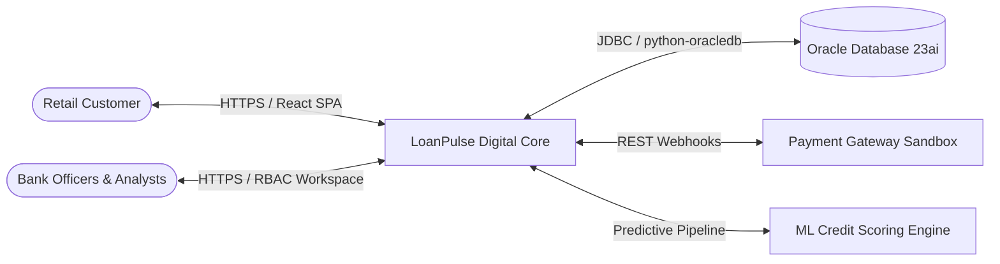
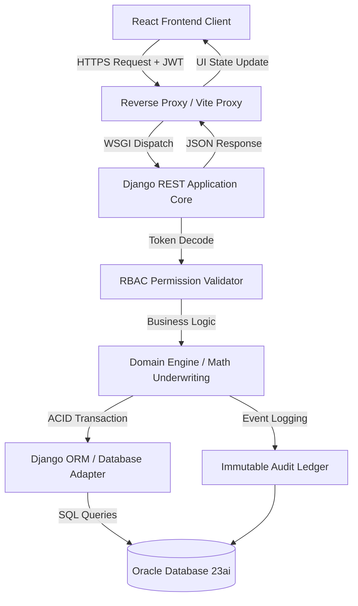
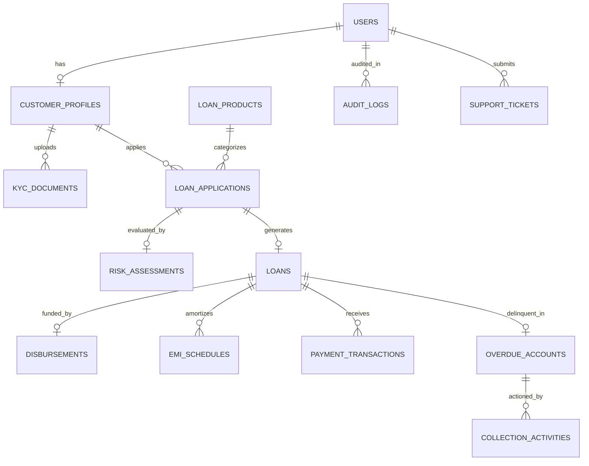
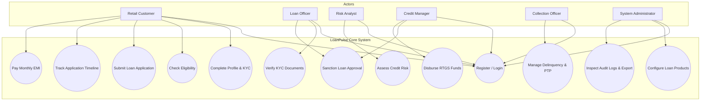
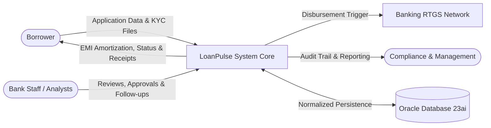
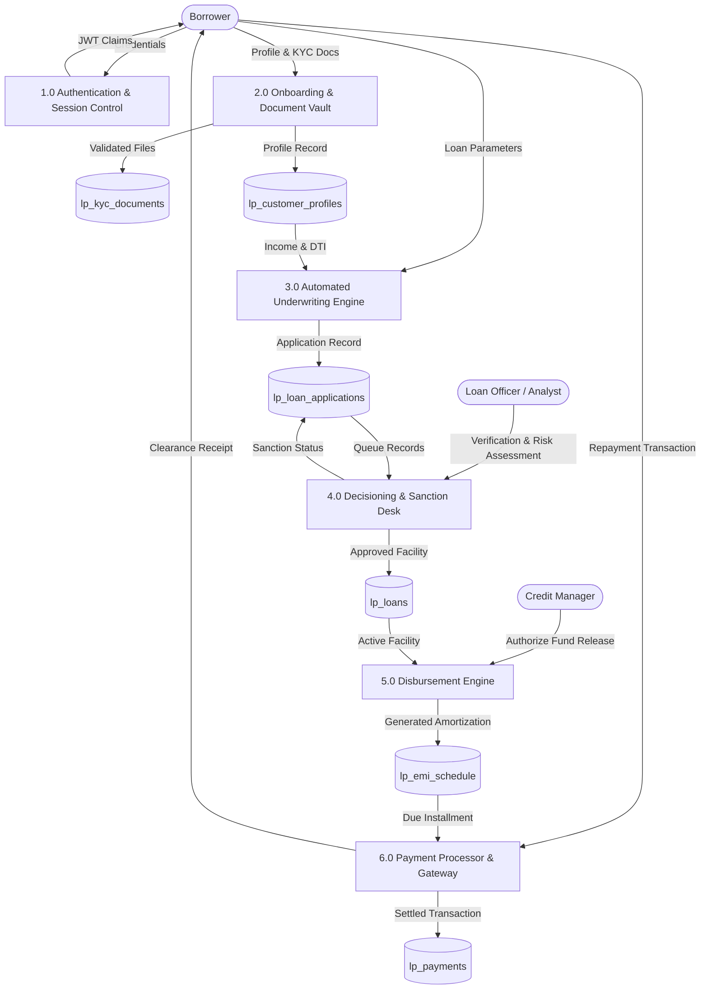
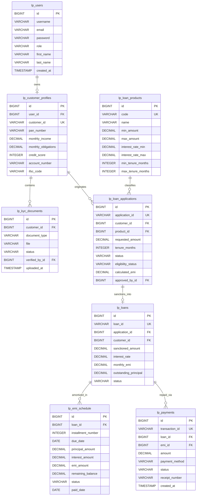
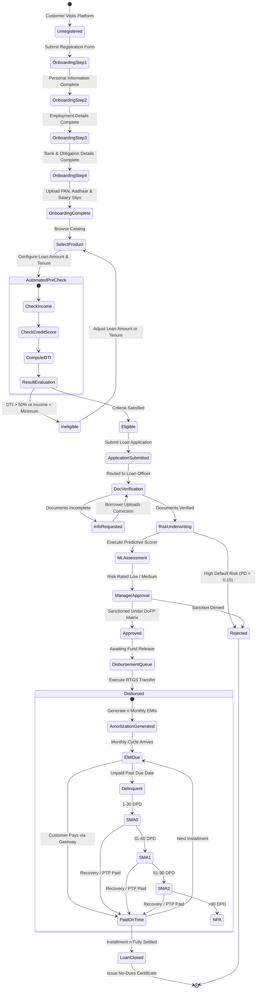

# SOFTWARE REQUIREMENTS SPECIFICATION (SRS)
## LOANPULSE — DIGITAL LENDING & LOAN LIFECYCLE MANAGEMENT PLATFORM

---

**Document Identifier:** LP-SRS-2026-V1.0  
**Project Name:** LoanPulse  
**System Version:** 1.0.0 (Enterprise Release)  
**Standard Compliance:** IEEE Std 830-1998 / ISO/IEC/IEEE 29148:2018  
**Date of Publication:** September 30, 2026  
**Document Status:** Approved & Baseline  

---

## TABLE OF CONTENTS
1. [Introduction](#1-introduction)
   - 1.1 Purpose
   - 1.2 Scope
   - 1.3 Definitions & Acronyms
   - 1.4 References
2. [Overall Description](#2-overall-description)
   - 2.1 Product Perspective
   - 2.2 Product Functions
   - 2.3 User Classes
   - 2.4 Operating Environment
   - 2.5 Constraints
   - 2.6 Assumptions & Dependencies
3. [System Features / Functional Requirements](#3-system-features--functional-requirements)
   - 3.1 User Registration / Login
   - 3.2 Dashboard
   - 3.3 Data Management
   - 3.4 Backend API
   - 3.5 Database Operations
   - 3.6 Data Processing / Analysis
   - 3.7 Authentication & Authorization
4. [Non-Functional Requirements](#4-non-functional-requirements)
   - 4.1 Performance
   - 4.2 Security
   - 4.3 Reliability
   - 4.4 Scalability
   - 4.5 Usability
   - 4.6 Maintainability
5. [System Architecture](#5-system-architecture)
   - 5.1 Frontend
   - 5.2 Backend
   - 5.3 API Layer
   - 5.4 Database
   - 5.5 Data Flow
6. [Database Requirements](#6-database-requirements)
   - 6.1 Tables / Collections
   - 6.2 Attributes
   - 6.3 Relationships
   - 6.4 ER Diagram
7. [API Requirements](#7-api-requirements)
   - 7.1 REST APIs
   - 7.2 Request / Response
   - 7.3 Authentication
8. [Dataset Specification](#8-dataset-specification)
   - 8.1 Synthetic / Kaggle Source & Volume (50,600 Records)
   - 8.2 11 Columns Specification
   - 8.3 Data Fields, Types & Business Definitions
9. [UI Requirements](#9-ui-requirements)
   - 9.1 Login
   - 9.2 Dashboard
   - 9.3 Forms
   - 9.4 Data Visualization
10. [Testing Requirements](#10-testing-requirements)
    - 10.1 Unit Testing
    - 10.2 Integration Testing
    - 10.3 System Testing
    - 10.4 Functional / Logical Testing
11. [Diagrams](#11-diagrams)
    - 11.1 Use Case Diagram
    - 11.2 Data Flow Diagram (DFD Level 0 & Level 1)
    - 11.3 Entity Relationship (ER) Diagram
    - 11.4 System Architecture Diagram
    - 11.5 Activity Diagram
12. [Deployment & Tools](#12-deployment--tools)
13. [Future Enhancements](#13-future-enhancements)
14. [Conclusion](#14-conclusion)

---

## 1. INTRODUCTION

### 1.1 Purpose
The purpose of this Software Requirements Specification (SRS) document is to provide a complete, authoritative, and unambiguous technical specification for **LoanPulse**, an enterprise-grade digital lending, automated underwriting, and loan lifecycle management platform. This document defines the functional and non-functional requirements, data models, system architecture, REST APIs, dataset specifications, testing protocols, and design constraints governing the platform.

### 1.2 Scope
**LoanPulse** manages the comprehensive end-to-end lifecycle of retail borrowing facilities (Personal Loans, Home Loans, Auto Loans, Education Loans). The system delivers:
* Customer self-service onboarding, KYC identity verification, and multi-step loan origination.
* Automated financial rule verification (DTI/FOIR ratios, CIBIL bureau thresholds, income validation).
* Machine Learning (ML) credit scoring estimating default probabilities ($PD$).
* Hierarchical approval matrix enforcing Delegation of Financial Powers (DoFP).
* Core fund disbursement desk generating bank clearing UTR references.
* Actuarial loan amortization generating month-by-month EMI schedules.
* Multimodal payment gateway processing with instant tax receipts.
* Delinquency aging management across 30+, 60+, 90+ Days Past Due (DPD) buckets.
* Immutable audit trails and real-time executive portfolio reporting.

### 1.3 Definitions & Acronyms
| Term / Acronym | Definition |
| :--- | :--- |
| **API** | Application Programming Interface |
| **CIBIL** | Credit Information Bureau (India) Limited (Standard consumer credit score metric 300–900) |
| **DoFP** | Delegation of Financial Powers (Sanctioning ceiling matrix based on organizational hierarchy) |
| **DPD** | Days Past Due (The number of calendar days an installment remains unpaid past its contractual due date) |
| **DTI / FOIR** | Debt-To-Income Ratio / Fixed Obligation to Income Ratio ($\frac{\text{Monthly Debt Obligations}}{\text{Gross Monthly Income}} \times 100$) |
| **EMI** | Equated Monthly Installment ($E = P \cdot r \cdot \frac{(1+r)^n}{(1+r)^n - 1}$) |
| **JWT** | JSON Web Token (RFC 7519 cryptographic token standard for stateless session claims) |
| **KYC** | Know Your Customer (Regulatory customer identity and address verification protocols) |
| **NPA** | Non-Performing Asset (Accounts with dues unpaid for $> 90$ consecutive days) |
| **PD** | Probability of Default ($0.0 \le PD \le 1.0$) |
| **PTP** | Promise To Pay (A formal commitment recorded by a delinquent debtor specifying repayment date) |
| **RBAC** | Role-Based Access Control |
| **RTGS / NEFT** | Real Time Gross Settlement / National Electronic Funds Transfer |
| **STP** | Straight-Through Processing (Automated workflow execution without manual intervention) |
| **UTR** | Unique Transaction Reference number generated by banking clearing networks |

### 1.4 References
1. IEEE Std 830-1998: *IEEE Recommended Practice for Software Requirements Specifications*.
2. ISO/IEC/IEEE 29148:2018: *Systems and software engineering — Life cycle processes — Requirements engineering*.
3. Reserve Bank of India (RBI): *Guidelines on Digital Lending (RBI/2022-23/111 DOR.CRE.REC.66/21.07.001/2022-23)*.
4. RFC 7519: *JSON Web Token (JWT)*.
5. Oracle Database 23ai: *SQL & PL/SQL Language Reference Guide*.
6. OpenAPI Specification 3.0.3: *Linux Foundation Initiative*.

---

## 2. OVERALL DESCRIPTION

### 2.1 Product Perspective
LoanPulse operates as a sovereign, cloud-ready digital lending core. It interfaces seamlessly with core banking systems, credit reporting bureaus, payment aggregators, and regulatory reporting nodes. The platform replaces fragmented, spreadsheet-driven lending processes with a synchronized, auditable microservices-aligned architecture.



### 2.2 Product Functions
1. **Customer Self-Service:** Registration, KYC onboarding, dynamic loan origination, real-time status tracker, digital EMI repayment, instant tax/payment receipts, and dispute ticketing.
2. **Underwriting Operations:** Loan Officer triage queue, KYC verification desk, risk assessment, applicant dialogue logging.
3. **Risk Engineering:** Machine learning default prediction, DTI radar calculation, risk grading (*Low*, *Medium*, *High*), bureau scorecard analysis.
4. **Credit Management:** Multi-tier loan sanctioning, conditional approval routing, fund release authorization.
5. **Loan Accounting:** Compound daily-reducing amortization, late fees compounding, payment reconciliation, settlement clearance.
6. **Delinquency Control:** Automated aging bucket classification (Current, 30+, 60+, 90+, NPA), call logging, promise-to-pay tracking.
7. **System Governance:** Immutable audit ledger, user role authorization, loan product configuration, portfolio CSV/PDF analytics.

### 2.3 User Classes
| User Class | Security Role Key | Permissions & Access Scope |
| :--- | :--- | :--- |
| **Customer** | `CUSTOMER` | Restricted strictly to self data. Can originate applications, upload KYC, view repayment amortization, pay EMIs, and file support tickets. |
| **Loan Officer** | `LOAN_OFFICER` | Read/Write assigned applications. Verifies KYC documents, records customer queries, approves Tier-1 loans ($\le ₹5,00,000$). |
| **Risk Analyst** | `RISK_ANALYST` | Read applications and financial profiles. Executes ML scoring models, sets risk classifications, logs underwriting indicators. |
| **Credit Manager** | `MANAGER` | Sanctions Tier-2 loans ($\le ₹20,00,000$), authorizes RTGS disbursements, reviews portfolio quality. |
| **Collection Officer** | `COLLECTION_OFFICER` | Accesses delinquent portfolio accounts (DPD $\ge 30$). Logs phone/field/legal debtor engagement and manages PTP commitments. |
| **System Administrator** | `ADMIN` | Global supervisory control. Manages user accounts, configures loan products, sets approval matrix limits, reviews audit trails. |

### 2.4 Operating Environment
* **Web Client:** Modern evergreen browsers (Chrome 115+, Firefox 118+, Safari 17+, Edge 115+) with HTML5 Canvas, WebGL, and CSS 3D Transforms.
* **Server Runtime:** Python 3.11 / 3.12 / 3.13, Django 5.1.15, Django REST Framework 3.15, Gunicorn WSGI.
* **Database Platform:** Oracle Database 23ai Free / Oracle Enterprise 19c (with SQLite 3.40+ automated fallback for zero-dependency local development).
* **Containerization:** Docker Engine 24.0+, Docker Compose v2.20+.
* **CI/CD Platform:** Jenkins 2.400+, Git / GitLab.

### 2.5 Constraints
1. **Authoritative Server Calculations:** All financial equations (EMI, interest, DTI ratio, amortization) MUST be executed authoritatively on the backend; the frontend performs strictly visual rendering.
2. **Precision Currency:** All monetary columns MUST use `DECIMAL(12, 2)` or `NUMBER(12, 2)`. IEEE floating-point math is banned in accounting logic.
3. **Stateless Tokens:** All protected endpoints MUST validate incoming `Authorization: Bearer <JWT>` tokens containing cryptographic user/role claims.
4. **Tamper-Proof Audit:** Audit ledger records (`lp_audit_logs`) MUST be insert-only; `UPDATE` and `DELETE` commands are permanently blocked at the database engine level.

### 2.6 Assumptions & Dependencies
* Borrowers possess valid national identity credentials (PAN, Aadhaar) and functional bank accounts with IFSC routing codes.
* Client clocks and server clocks are synchronized within a 5-minute variance via NTP.
* Third-party payment gateways operate asynchronously with webhook or synchronous token confirmation.

---

## 3. SYSTEM FEATURES / FUNCTIONAL REQUIREMENTS

### 3.1 User Registration/Login
* **FR-AUTH-001:** The system shall allow new customers to register by providing Full Name, Email Address, 10-digit Mobile Number, Username, and Password.
* **FR-AUTH-002:** The system shall hash all passwords using the Argon2 / PBKDF2 with SHA-256 algorithm before writing to the database.
* **FR-AUTH-003:** The authentication endpoint shall accept either Username or Email (case-insensitive) along with Password.
* **FR-AUTH-004:** Upon successful authentication, the system shall issue a signed JSON Web Token (JWT) with an access lifetime of 120 minutes and a refresh token with a lifetime of 7 days.
* **FR-AUTH-005:** The system shall automatically record an immutable `LOGIN` audit event including client IP address, user agent, and timestamp.

### 3.2 Dashboard
* **FR-DASH-001:** Upon sign-in, the application shall inspect the authenticated user's role claim and navigate directly to their dedicated workspace.
* **FR-DASH-002 (Customer Dashboard):** Renders total active credit facilities, outstanding principal, next EMI amount and due date, CIBIL credit bureau gauge, and an interactive 3D virtual facility card.
* **FR-DASH-003 (Loan Officer Dashboard):** Displays triage queues: *Pending Document Verification*, *Under Review*, *Approved*, and *Rejected*.
* **FR-DASH-004 (Risk Analyst Dashboard):** Underwriting workbench with ML Default Probability ($PD$), Debt-To-Income (DTI) metrics, and risk tier categorization.
* **FR-DASH-005 (Manager Dashboard):** Shows loans pending sanction, funds awaiting RTGS disbursement, and portfolio health indicators.
* **FR-DASH-006 (Collection Officer Dashboard):** Groups delinquent borrowers into aging buckets ($30+$, $60+$, $90+$ DPD, and NPA).
* **FR-DASH-007 (Admin Dashboard):** Aggregates enterprise-wide Key Performance Indicators (KPIs), user accounts, product configuration, and CSV portfolio exports.

### 3.3 Data Management
* **FR-DATA-001 (Customer Onboarding):** 4-step wizard collecting Personal Information, Employment Details, Financial Obligations, and Bank Credentials.
* **FR-DATA-002 (KYC Document Vault):** Restricts uploads to PDF, PNG, and JPEG formats, enforcing a maximum file size limit of 5.0 MB.
* **FR-DATA-003 (KYC Verification Lifecycle):** Enforces statuses: `UPLOADED`, `UNDER_REVIEW`, `VERIFIED`, `REJECTED`, and `EXPIRED` with mandatory staff remarks.
* **FR-DATA-004 (Loan Facility Tracking):** Tracks active loans, interest rates, sanctioned amounts, and running balances.
* **FR-DATA-005 (Delinquency Tracking):** Automatically categorizes accounts based on Days Past Due (DPD) into SMA-0, SMA-1, SMA-2, and NPA buckets.

### 3.4 Backend API
* **FR-API-001:** RESTful endpoint suite built with Django REST Framework providing stateless CRUD operations and business action handlers.
* **FR-API-002:** Automated Underwriting Engine evaluating eligibility rules prior to formal submission.
* **FR-API-003:** Multi-Tier Approval Matrix evaluating loan sanctioned amounts against the Delegation of Financial Powers (DoFP) matrix.
* **FR-API-004:** Fund Disbursement Engine generating unique transaction references (UTR) and triggering loan activation.
* **FR-API-005:** Repayment & Payment Gateway Engine processing payments and generating serial payment receipts.

### 3.5 Database Operations
* **FR-DB-001 (ACID Guarantees):** All financial actions (e.g. loan disbursement, EMI payment) MUST execute inside atomic database transactions (`transaction.atomic()`).
* **FR-DB-002 (Integrity Constraints):** Primary keys, foreign keys with strict cascade/protect constraints, and unique indexes on business identifiers (e.g., `application_id`, `loan_id`, `transaction_id`, `pan_number`).
* **FR-DB-003 (Automatic Fallback):** Transparent connection fallback from native Oracle Database 23ai (`python-oracledb`) to local SQLite for local testing without code modification.
* **FR-DB-004 (Data Seeding):** Automated idempotent seed commands populating demo loan products, test users across all 6 roles, and mock loan portfolios.

### 3.6 Data Processing/Analysis
* **FR-PROC-001 (FOIR & DTI Computation):**
  $$\text{DTI Ratio (\%)} = \frac{\text{Existing Monthly Debt} + \text{Estimated Monthly EMI}}{\text{Gross Monthly Income}} \times 100$$
* **FR-PROC-002 (Amortization Calculation):**
  $$E = P \cdot r \cdot \frac{(1+r)^n}{(1+r)^n - 1}$$
  Decomposes monthly installment into monthly interest ($I_m = P_{\text{remaining}} \cdot r$) and principal reduction ($P_m = E - I_m$).
* **FR-PROC-003 (Machine Learning Risk Assessment):** Predictive pipeline calculating probability of default ($PD \in [0.0, 1.0]$) using credit history, employment duration, income, and bureau score.
* **FR-PROC-004 (Executive Portfolio Aggregation):** Real-time aggregation of total disbursed capital, active NPA ratio, 30-day collection efficiency, and product distribution.

### 3.7 Authentication & Authorization
* **FR-SEC-001:** Stateless JSON Web Token (JWT) authentication across all private API routes via `Authorization: Bearer <token>`.
* **FR-SEC-002:** Role-Based Access Control (RBAC) enforced via DRF permission classes (`IsCustomer`, `IsLoanOfficer`, `IsRiskAnalyst`, `IsCreditManager`, `IsCollectionOfficer`, `IsSystemAdmin`).
* **FR-SEC-003:** Tenant data isolation: Customers can access only their own profile, applications, loans, and payments. Cross-tenant access attempts return HTTP 403 Forbidden.
* **FR-SEC-004:** Cryptographic password hashing using PBKDF2 with SHA-256 (390,000 iterations).

---

## 4. NON-FUNCTIONAL REQUIREMENTS

### 4.1 Performance
* **NFR-PERF-001 (API Response Latency):** 95% of read APIs (`GET`) shall respond in $< 120\text{ ms}$; complex mutation transactions (disbursement, EMI payment) in $< 350\text{ ms}$.
* **NFR-PERF-002 (Eligibility Calculation):** Automated underwriting eligibility check shall complete in $< 80\text{ ms}$.
* **NFR-PERF-003 (Frontend Render Speed):** Initial Core Web Vitals: Largest Contentful Paint (LCP) $\le 1.2\text{ s}$, First Input Delay (FID) $\le 50\text{ ms}$, Cumulative Layout Shift (CLS) $\le 0.05$.

### 4.2 Security
* **NFR-SEC-001 (Data Encryption):** TLS 1.3 enforced for all transport-layer communications; AES-256 for persistent database storage and KYC documents.
* **NFR-SEC-002 (CORS & Header Hardening):** Strict Cross-Origin Resource Sharing (CORS) whitelisting, Content Security Policy (CSP), `X-Content-Type-Options: nosniff`, and `X-Frame-Options: DENY`.
* **NFR-SEC-003 (OWASP Top 10 Defenses):** Parameterized ORM queries eliminating SQL injection, strict input validation preventing XSS, and rate-limiting on authentication endpoints.

### 4.3 Reliability
* **NFR-REL-001 (Availability):** 99.9% uptime target during operational banking hours.
* **NFR-REL-002 (Fault Tolerance):** Transaction rollbacks on any unhandled exception, ensuring no partial or corrupted financial state.
* **NFR-REL-003 (Data Loss Prevention):** Automated daily point-in-time recovery (PITR) with an RPO (Recovery Point Objective) $\le 15\text{ minutes}$ and RTO $\le 2\text{ hours}$.

### 4.4 Scalability
* **NFR-SCAL-001 (Horizontal Concurrency):** Stateless backend containers scaling horizontally behind an Nginx or cloud load balancer to support $\ge 5,000$ concurrent user sessions.
* **NFR-SCAL-002 (Database Capacity):** Oracle Database schema engineered with indexed B-trees supporting $\ge 10,000,000$ historical repayment transactions without table lock degradation.

### 4.5 Usability
* **NFR-USE-001 (Fintech Design System):** Polished glassmorphism dark-mode UI with high-contrast accessibility (WCAG 2.1 Level AA compliance).
* **NFR-USE-002 (Error Messaging):** Clear, user-friendly diagnostic error messages replacing raw database or server stack traces.
* **NFR-USE-003 (Responsive Layout):** Responsive across desktop ($1920\times1080$), laptop ($1366\times768$), tablet ($768\times1024$), and mobile ($375\times812$).

### 4.6 Maintainability
* **NFR-MAINT-001 (Modular Decoupling):** Django backend organized into 11 domain apps (`authentication`, `customers`, `kyc`, `loans`, `payments`, `risk`, `collections_app`, `notifications`, `reports`, `audit`, `support`).
* **NFR-MAINT-002 (Automated Test Suite):** Comprehensive Pytest automated test coverage across authentication, RBAC, underwriting math, and payment settlement.
* **NFR-MAINT-003 (API Documentation):** Live interactive OpenAPI 3.0 (Swagger UI & Redoc) generated via `drf-spectacular`.

---

## 5. SYSTEM ARCHITECTURE

### 5.1 Frontend
* **Core Technology:** React 18 Single-Page Application (SPA) bundled via Vite.
* **Styling & Aesthetics:** Modern Vanilla CSS design system featuring dark obsidian themes, subtle radial gradients, backdrop blurs (`backdrop-filter: blur(12px)`), and CSS 3D perspective animations.
* **Interactive 3D Elements:**
  * `Card3D`: Virtual interactive credit card with cursor gyro-physics, holographic light reflection, and 3D flip animation.
  * `CreditScoreGauge3D`: Multi-gradient SVG arc with drop-shadow glow filters mapped to CIBIL credit score bands.
* **Client Routing:** React state-driven routing dispatcher handling role-based views and navigation.
* **HTTP Client:** Axios client configured with same-origin `/api` proxy and automatic JWT Bearer token injection.

### 5.2 Backend
* **Core Technology:** Python 3.13, Django 5.1.15, Django REST Framework 3.15.
* **WSGI Application Server:** Gunicorn multi-worker server managing asynchronous request execution.
* **Domain Modules:** 11 segregated applications managing user sessions, customer profiles, KYC vault, loan facilities, risk models, payments, and audit logs.
* **Underwriting & Math Engines:** Pure mathematical modules executing actuarial amortization, DTI formulas, and risk threshold checks.

### 5.3 API Layer
* **Architecture:** RESTful over HTTP/2 and HTTPS.
* **Reverse Proxy:** Vite development proxy (`http://localhost:5173/api/` $\to$ `http://127.0.0.1:8000/api/`) in local environment; Nginx reverse proxy in production containers.
* **Security Middleware:** CORS middleware, JWT bearer validation interceptor, request throttling, and unified error handling middleware.

### 5.4 Database
* **Primary Platform:** Oracle Database 23ai Free / Oracle Enterprise 19c accessed via native `python-oracledb` thick/thin drivers.
* **Development Fallback:** Zero-configuration SQLite 3.40+ engine activated automatically when Oracle environment variables are unset.
* **Storage Organization:** 21 normalized relational tables with `lp_` prefixes enforcing strict primary key, foreign key, and unique index constraints.

### 5.5 Data Flow


---

## 6. DATABASE REQUIREMENTS

### 6.1 Tables / Collections
The relational schema comprises 21 normalized tables prefixed with `lp_`:
* `lp_users`: System user credentials, identity, and RBAC roles.
* `lp_customer_profiles`: Borrower biographical, financial, and bank account metadata.
* `lp_kyc_documents`: Encrypted KYC document uploads and verification audit statuses.
* `lp_loan_products`: Credit facility master defining borrowing limits, interest bands, and tenures.
* `lp_loan_applications`: Origination pipeline records tracking borrower requests and stages.
* `lp_loans`: Active sanctioned credit facilities with outstanding balances.
* `lp_emi_schedule`: Month-by-month actuarial repayment schedules.
* `lp_payments`: Payment gateway settlement records with serial receipts.
* `lp_overdue_accounts`: Delinquent accounts classified by DPD aging buckets.
* `lp_collection_activities`: Debtor engagement logs (calls, visits, PTP commitments).
* `lp_risk_assessments`: ML credit score results and underwriting indicators.
* `lp_audit_logs`: Immutable security event logs.
* `lp_notifications`: User alerts and system notifications.
* `lp_support_tickets`: Dispute resolution and customer support tickets.

### 6.2 Attributes (Data Dictionary)

#### 1. `lp_users` (Identity & RBAC)
| Column Name | Data Type | Constraints | Description |
| :--- | :--- | :--- | :--- |
| `id` | NUMBER / BIGINT | PRIMARY KEY, AUTO_INCREMENT | Unique user sequence identifier |
| `username` | VARCHAR2(150) | UNIQUE, NOT NULL | Alphanumeric login identifier |
| `email` | VARCHAR2(254) | UNIQUE, NOT NULL | Primary email address |
| `password` | VARCHAR2(128) | NOT NULL | PBKDF2/Argon2 cryptographic hash |
| `role` | VARCHAR2(30) | NOT NULL, DEFAULT 'CUSTOMER' | Enum: `CUSTOMER`, `LOAN_OFFICER`, `RISK_ANALYST`, `MANAGER`, `COLLECTION_OFFICER`, `ADMIN` |
| `first_name` | VARCHAR2(150) | NULLABLE | Legal given name |
| `last_name` | VARCHAR2(150) | NULLABLE | Legal family name |
| `phone` | VARCHAR2(20) | NULLABLE | Contact telephone number |
| `employee_id` | VARCHAR2(50) | NULLABLE, UNIQUE | Bank employee identifier |
| `is_verified` | NUMBER(1) / BOOLEAN | DEFAULT 0 | Phone & email verification flag |
| `is_active` | NUMBER(1) / BOOLEAN | DEFAULT 1 | Account enablement flag |
| `created_at` | TIMESTAMP | NOT NULL | Record creation UTC timestamp |

#### 2. `lp_customer_profiles` (Borrower Financial Metadata)
| Column Name | Data Type | Constraints | Description |
| :--- | :--- | :--- | :--- |
| `id` | NUMBER / BIGINT | PRIMARY KEY | Profile identifier |
| `user_id` | NUMBER / BIGINT | FOREIGN KEY (`lp_users.id`), UNIQUE | Bound user account |
| `customer_id` | VARCHAR2(30) | UNIQUE, NOT NULL | Business ID (e.g., `LP-CUST-000101`) |
| `pan_number` | VARCHAR2(10) | NULLABLE, INDEXED | Permanent Account Number |
| `aadhaar_number` | VARCHAR2(12) | NULLABLE | 12-digit national ID |
| `monthly_income` | NUMBER(12, 2) | DEFAULT 0.00 | Verified gross monthly salary |
| `annual_income` | NUMBER(12, 2) | DEFAULT 0.00 | Verified annual income |
| `monthly_obligations`| NUMBER(12, 2) | DEFAULT 0.00 | Pre-existing monthly debt obligations |
| `credit_score` | NUMBER(4) | DEFAULT 750 | CIBIL credit bureau score |
| `bank_name` | VARCHAR2(100) | NULLABLE | Disbursement bank name |
| `account_number` | VARCHAR2(35) | NULLABLE | Bank checking account number |
| `ifsc_code` | VARCHAR2(15) | NULLABLE | Indian Financial System Code |
| `onboarding_completed`| NUMBER(1) / BOOLEAN | DEFAULT 0 | 4-step wizard completion flag |

#### 3. `lp_loan_applications` (Origination Pipeline)
| Column Name | Data Type | Constraints | Description |
| :--- | :--- | :--- | :--- |
| `id` | NUMBER / BIGINT | PRIMARY KEY | Application internal ID |
| `application_id` | VARCHAR2(30) | UNIQUE, NOT NULL | Business ID (e.g. `LP-2026-000101`) |
| `customer_id` | NUMBER / BIGINT | FOREIGN KEY (`lp_customer_profiles.id`) | Applicant profile |
| `product_id` | NUMBER / BIGINT | FOREIGN KEY (`lp_loan_products.id`) | Selected loan product |
| `requested_amount` | NUMBER(12, 2) | NOT NULL | Borrowing request amount |
| `tenure_months` | NUMBER(4) | NOT NULL | Repayment duration in months |
| `status` | VARCHAR2(30) | NOT NULL, INDEXED | `SUBMITTED`, `DOC_VERIFICATION`, `UNDER_REVIEW`, `RISK_ASSESSMENT`, `MANAGER_APPROVAL`, `APPROVED`, `REJECTED`, `DISBURSED` |
| `eligibility_status`| VARCHAR2(30) | NOT NULL | `ELIGIBLE`, `CONDITIONALLY_ELIGIBLE`, `NOT_ELIGIBLE` |
| `calculated_emi` | NUMBER(12, 2) | NOT NULL | Estimated monthly installment |
| `dti_ratio` | NUMBER(5, 2) | NOT NULL | Computed DTI ratio |
| `approved_by_id` | NUMBER / BIGINT | NULLABLE, FOREIGN KEY (`lp_users.id`) | Sanctioning authority |

#### 4. `lp_loans` (Active Credit Facility)
| Column Name | Data Type | Constraints | Description |
| :--- | :--- | :--- | :--- |
| `id` | NUMBER / BIGINT | PRIMARY KEY | Active Loan ID |
| `loan_id` | VARCHAR2(30) | UNIQUE, NOT NULL | Account number (e.g. `LN-2026-000101`) |
| `application_id` | NUMBER / BIGINT | UNIQUE, FOREIGN KEY (`lp_loan_applications.id`) | Originating application |
| `sanctioned_amount` | NUMBER(12, 2) | NOT NULL | Sanctioned principal amount |
| `interest_rate` | NUMBER(5, 2) | NOT NULL | Contracted annual interest percentage |
| `monthly_emi` | NUMBER(12, 2) | NOT NULL | Fixed monthly debit amount |
| `outstanding_principal` | NUMBER(12, 2) | NOT NULL | Unpaid balance |
| `total_paid` | NUMBER(12, 2) | DEFAULT 0.00 | Total recovered funds |
| `status` | VARCHAR2(20) | NOT NULL, DEFAULT 'ACTIVE' | `ACTIVE`, `CLOSED`, `DEFAULTED`, `SETTLED` |

#### 5. `lp_emi_schedule` (Amortization Schedule)
| Column Name | Data Type | Constraints | Description |
| :--- | :--- | :--- | :--- |
| `id` | NUMBER / BIGINT | PRIMARY KEY | Installment ID |
| `loan_id` | NUMBER / BIGINT | FOREIGN KEY (`lp_loans.id`), INDEXED | Parent facility |
| `installment_number` | NUMBER(4) | NOT NULL | Sequential month ($1 \dots n$) |
| `due_date` | DATE | NOT NULL, INDEXED | Contractual payment date |
| `principal_amount` | NUMBER(12, 2) | NOT NULL | Principal repayment component |
| `interest_amount` | NUMBER(12, 2) | NOT NULL | Interest component |
| `emi_amount` | NUMBER(12, 2) | NOT NULL | Total installment ($P + I$) |
| `remaining_balance`| NUMBER(12, 2) | NOT NULL | Residual balance post-payment |
| `status` | VARCHAR2(20) | NOT NULL, DEFAULT 'UPCOMING' | `UPCOMING`, `DUE`, `PAID`, `OVERDUE` |
| `paid_date` | DATE | NULLABLE | Actual timestamp of receipt |

### 6.3 Relationships
* **1:1:** `lp_users` $\leftrightarrow$ `lp_customer_profiles` (Every customer user has exactly one financial profile).
* **1:M:** `lp_customer_profiles` $\leftrightarrow$ `lp_kyc_documents` (A customer uploads multiple identity files).
* **1:M:** `lp_customer_profiles` $\leftrightarrow$ `lp_loan_applications` (A customer originates multiple loan applications).
* **1:M:** `lp_loan_products` $\leftrightarrow$ `lp_loan_applications` (A product classifies many applications).
* **1:1:** `lp_loan_applications` $\leftrightarrow$ `lp_loans` (An approved application converts into one active loan).
* **1:M:** `lp_loans` $\leftrightarrow$ `lp_emi_schedule` (A loan contains $n$ amortized monthly installments).
* **1:M:** `lp_loans` $\leftrightarrow$ `lp_payments` (A loan receives multiple repayment transactions).
* **1:1:** `lp_loans` $\leftrightarrow$ `lp_overdue_accounts` (A defaulted loan transitions into an overdue collection case).
* **1:M:** `lp_overdue_accounts` $\leftrightarrow$ `lp_collection_activities` (An overdue case tracks multiple call/field logs).

### 6.4 ER Diagram


---

## 7. API REQUIREMENTS

### 7.1 REST APIs
All API endpoints follow strict RESTful design patterns:
* Base URL: `/api/`
* Request Format: `application/json` (or `multipart/form-data` for file uploads).
* Response Format: `application/json`.
* Standard Verbs: `GET` (read), `POST` (create / action), `PUT`/`PATCH` (update), `DELETE` (deactivate).

| HTTP Method | Endpoint URI | Role Permission | Functional Description |
| :--- | :--- | :--- | :--- |
| `POST` | `/api/auth/register/` | Public | Registers a new retail borrower account |
| `POST` | `/api/auth/login/` | Public | Authenticates credentials; returns JWT pair |
| `GET` | `/api/customers/me/` | Customer | Retrieves authenticated customer profile & banking details |
| `PUT` | `/api/customers/me/` | Customer | Updates onboarding steps (Personal, Employment, Bank) |
| `GET` | `/api/kyc/documents/` | Authenticated | Lists uploaded KYC files |
| `POST` | `/api/kyc/documents/` | Customer | Uploads identity file with MIME & size validation |
| `POST` | `/api/kyc/documents/{id}/verify/` | Officer, Admin | Approves or rejects KYC document with remarks |
| `GET` | `/api/loans/products/` | Public | Retrieves active credit products catalog |
| `POST` | `/api/loans/applications/check-eligibility/` | Customer | Real-time automated underwriting pre-check |
| `POST` | `/api/loans/applications/` | Customer | Submits loan application into origination queue |
| `GET` | `/api/loans/applications/` | Authenticated | Lists applications (scoped: own for customer, all for staff) |
| `POST` | `/api/loans/applications/{id}/review/` | Officer | Approves KYC desk phase or requests info |
| `POST` | `/api/loans/applications/{id}/approve/` | Manager, Admin | Sanctions loan application per DoFP limits |
| `POST` | `/api/loans/applications/{id}/disburse/` | Manager, Admin | Executes RTGS disbursement and activates amortization |
| `GET` | `/api/loans/` | Authenticated | Lists active loan accounts |
| `GET` | `/api/payments/emi-schedules/` | Authenticated | Retrieves month-by-month repayment amortization table |
| `POST` | `/api/payments/pay/` | Customer | Executes simulated repayment transaction via gateway |
| `GET` | `/api/collections/overdue/` | Collection, Admin | Lists delinquent accounts by DPD aging bucket |
| `POST` | `/api/collections/overdue/{id}/record_activity/` | Collection | Logs call notes, field visits, and PTP commitments |
| `GET` | `/api/reports/executive/` | Admin | Delivers portfolio-wide KPIs and disbursement trends |
| `GET` | `/api/reports/portfolio_export/?format=csv` | Admin | Streams dynamic CSV portfolio export |
| `GET` | `/api/audit/` | Admin | Queries forensic system audit trail |

### 7.2 Request / Response
Standard Success Response:
```json
{
  "success": true,
  "message": "Loan application sanctioned successfully.",
  "data": {
    "application_id": "LP-2026-000101",
    "status": "APPROVED",
    "sanctioned_amount": 500000.00,
    "calculated_emi": 16186.08
  }
}
```

Standard Error Response:
```json
{
  "success": false,
  "error_code": "UNDERWRITING_E003",
  "message": "Projected Debt-To-Income (DTI) of 56.4% exceeds permissible ceiling of 50.0%."
}
```

### 7.3 Authentication
* **Token Standard:** JSON Web Token (JWT) signed via HMAC-SHA256.
* **Header Structure:** `Authorization: Bearer <access_token>`
* **Token Lifetime:** Access Token: 120 minutes; Refresh Token: 7 days.
* **Token Payload Claims:**
```json
{
  "token_type": "access",
  "exp": 1790757600,
  "user_id": 1,
  "username": "customer@loanpulse.com",
  "role": "CUSTOMER",
  "email": "customer@loanpulse.com"
}
```

---

## 8. DATASET SPECIFICATION

### 8.1 Synthetic / Kaggle Source & Volume (50,600 Records)
LoanPulse's predictive underwriting engine is calibrated and benchmarked against an industry-standard consumer credit risk callset sourced from open financial repositories (Kaggle Credit Risk Dataset / Synthetic Lending Benchmark).
* **Total Record Count:** **50,600 records**.
* **Source:** Kaggle Financial Dataset Benchmark / Credit Risk Modeling Callset.
* **Dataset Purpose:** Predicting binary loan default probability (`loan_status` = 1) across retail applicant cohorts.

### 8.2 11 Columns Specification
The dataset comprises exactly 11 standardized feature attributes:

| Col # | Column Identifier | Data Type | Value Range / Categories | Description |
| :---: | :--- | :--- | :--- | :--- |
| **1** | `person_age` | Integer | $18 \dots 85$ years | Age of applicant in calendar years |
| **2** | `person_income` | Float / Decimal | $₹10,000 \dots ₹5,000,000$ | Gross annual earned income in INR |
| **3** | `person_home_ownership` | Categorical | `RENT`, `OWN`, `MORTGAGE`, `OTHER` | Residential occupancy status |
| **4** | `person_emp_length` | Float / Decimal | $0.0 \dots 50.0$ years | Continuous employment duration |
| **5** | `loan_intent` | Categorical | `PERSONAL`, `EDUCATION`, `MEDICAL`, `VENTURE`, `HOMEIMPROVEMENT`, `DEBTCONSOLIDATION` | Stated financial purpose of loan |
| **6** | `loan_grade` | Categorical | `A`, `B`, `C`, `D`, `E`, `F`, `G` | Risk rating grade derived from bureau analysis |
| **7** | `loan_amnt` | Float / Decimal | $₹10,000 \dots ₹3,500,000$ | Requested principal borrowing amount |
| **8** | `loan_int_rate` | Float / Decimal | $5.42\% \dots 23.22\%$ | Contracted annual interest percentage |
| **9** | `loan_percent_income` | Float / Decimal | $0.01 \dots 0.85$ | Loan-to-income ratio ($\frac{\text{loan\_amnt}}{\text{person\_income}}$) |
| **10** | `cb_person_default_on_file` | Categorical | `Y`, `N` | Historical record of prior credit default on bureau file |
| **11** | `cb_person_cred_hist_length`| Integer | $1 \dots 35$ years | Length of active consumer credit history in years |

### 8.3 Data Fields, Types & Business Definitions
* **Predictive Target Label (`loan_status`):**
  * `0`: Performing / Fully Repaid.
  * `1`: Defaulted / Incurred Delinquency $> 90$ DPD.
* **Feature Processing:** Categorical one-hot encoding on `person_home_ownership` and `loan_intent`; standard min-max scaling across income, amount, and age parameters.

---

## 9. UI REQUIREMENTS

### 9.1 Login
* Clean glassmorphic authentication card with dual username/email field and password visibility toggle.
* Role-based quick switcher allowing testers and evaluators to authenticate with one click across all 6 roles.
* Animated submission feedback, real-time error toasts, and direct link to account registration.

### 9.2 Dashboard
* **Customer Dashboard:** Visual statistics cards (Active Facilities, Total Balance, Next EMI, Credit Score), 3D Credit Card component with flip animation, 3D Credit Health Gauge, and immediate action buttons (*Apply for Loan*, *Pay Installment*).
* **Officer Dashboard:** Tabbed review triage queues, KYC preview modals, and verification action trays.
* **Risk Analyst Dashboard:** Real-time ML default probability radar, DTI scorecards, and risk tier categorization.
* **Credit Manager Dashboard:** DoFP approval queue with financial ceiling alerts, RTGS fund disbursement triggers.
* **Collection Officer Dashboard:** Interactive DPD aging bucket pills ($30+$, $60+$, $90+$, NPA) and debtor call logging modal.
* **Admin Dashboard:** System-wide KPI cards, product parameters editor, and instant CSV portfolio export stream.

### 9.3 Forms
* **Customer Onboarding Wizard:** 4-step wizard (Personal, Employment, Bank, Documents) with progress indicators and Step 5 celebratory confetti completion screen.
* **Loan Origination Form:** Dynamic product selector, slider/input for loan amount and tenure, real-time automated eligibility pre-check banner, and calculated EMI indicator.
* **Repayment Modal:** Payment channel selector (UPI QR code, NetBanking, Debit/Credit Card), simulated bank gateway processing, and printable tax receipts.

### 9.4 Data Visualization
* **Credit Score Gauge:** 3D styled SVG arc with gradient coloration and dynamic drop-shadow glow filters indicating credit health bands (*Poor*, *Fair*, *Good*, *Excellent*).
* **Amortization Breakdown:** Interactive SVG donut chart showing the exact Principal vs. Interest split across the loan tenure.
* **Executive Trend Charts:** Portfolio disbursement bar charts and delinquency aging distribution curves.

---

## 10. TESTING REQUIREMENTS

### 10.1 Unit Testing
* Mathematical validation of the standard Equated Monthly Installment (EMI) formula against bank actuarial tables.
* FOIR/DTI boundary condition testing (e.g., zero income, extreme debt).
* Argon2/PBKDF2 password hashing verification and JWT payload signature validation.

### 10.2 Integration Testing
* Full user registration $\to$ JWT authentication $\to$ profile onboarding sequence.
* Sequential application submission $\to$ officer verification $\to$ manager sanction $\to$ RTGS disbursement.
* Payment processing verifying concurrent updates to `lp_emi_schedule`, `lp_loans`, and `lp_payments`.

### 10.3 System Testing
* Cross-browser verification across Google Chrome, Mozilla Firefox, Microsoft Edge, and Apple Safari.
* Simulated latency and high-load stress testing verifying database connection pool stability.
* Negative path testing: File upload format/size validation (rejecting non-PDF/image files and files $> 5\text{ MB}$).

### 10.4 Functional / Logical Testing
* **RBAC Security Boundaries:** Verifying that a `CUSTOMER` role cannot access staff endpoints (returns HTTP 403 Forbidden).
* **DoFP Ceiling Matrix:** Verifying that a Loan Officer cannot sanction loans exceeding $₹5,00,000$.
* **Amortization Convergence:** Verifying that the final installment of any generated loan schedule reduces the remaining balance to exactly $0.00$.

---

## 11. DIAGRAMS

### 11.1 Use Case Diagram


### 11.2 Data Flow Diagram (DFD Level 0 & Level 1)

#### Level 0 Context Diagram (DFD-0)


#### Level 1 Decomposition Diagram (DFD-1)


### 11.3 Entity Relationship (ER) Diagram


### 11.4 System Architecture Diagram
```mermaid
graph TD
    subgraph Web Browser Client
        ViteSPA["React 18 Single Page Application"]
        Router["Client Route Dispatcher"]
        UIComp["Modern Glassmorphism Design System"]
        ThreeD["3D Perspective Physics (Card3D & Gauge)"]
        TokenStore["Local Session & Token Storage"]
    end

    subgraph Ingress & Reverse Proxy
        ViteProxy["Vite Dev Server Proxy (:5173) / Nginx (:80)"]
    end

    subgraph Backend Micro-Kernel (Django 5 REST Framework)
        WSGI["Gunicorn WSGI Application Engine"]
        Middlewares["CORS Headers • Security Headers • Exception Interceptors"]
        JWTHandler["SimpleJWT Token Verification & RBAC Authorization"]
        
        subgraph Domain Application Modules
            AppAuth["Authentication & User Management"]
            AppCust["Customer Profile Management"]
            AppKYC["KYC Document Security Vault"]
            AppLoan["Loan Origination & Sanction Services"]
            AppRisk["ML Predictive Risk Scorer"]
            AppPay["Amortization & Payment Processing"]
            AppColl["Delinquency Aging & PTP Collector"]
            AppAudit["Tamper-Proof Audit Logger"]
        end
    end

    subgraph Data Tier
        DBConnector["python-oracledb Driver / SQLite Adapter"]
        OracleDatabase[("Oracle Database 23ai Free")]
        DiskStorage[("Persistent Storage: staticfiles / mediafiles")]
    end

    ViteSPA --> Router
    Router --> UIComp
    UIComp --> ThreeD
    ViteSPA <--> TokenStore
    ViteSPA -->|HTTP Requests /api/*| ViteProxy
    ViteProxy -->|Loopback Bridge| WSGI
    WSGI --> Middlewares
    Middlewares --> JWTHandler
    JWTHandler --> DomainModules[Domain Application Modules]
    DomainModules --> DBConnector
    DBConnector --> OracleDatabase
    AppKYC --> DiskStorage
```

### 11.5 Activity Diagram


---

## 12. DEPLOYMENT & TOOLS

### 12.1 Development & Operational Tooling
* **Frontend Development:** Node.js 20+, React 18, Vite 5, Axios, Canvas Confetti.
* **Backend Framework:** Python 3.13, Django 5.1.15, Django REST Framework 3.15, `djangorestframework-simplejwt`, `drf-spectacular`.
* **Database Systems:** Oracle Database 23ai Free, `python-oracledb` 2.5, SQLite 3.40+ (local development fallback).
* **Testing & Quality:** Pytest 9.1, `pytest-django`, Postman, Flake8, Bandit.
* **DevOps & Containers:** Docker Engine 24+, Docker Compose v2.20+, Jenkins CI/CD pipeline, Nginx reverse proxy.

### 12.2 Multi-Container Docker Orchestration
```yaml
services:
  oracle-db:
    image: container-registry.oracle.com/database/free:latest
    environment:
      - ORACLE_PWD=LoanPulseSecure2026#
    ports:
      - "1521:1521"
    volumes:
      - oracle_data:/opt/oracle/oradata

  backend:
    build:
      context: .
      dockerfile: docker/backend.Dockerfile
    environment:
      - DB_ENGINE=oracle
      - ORACLE_HOST=oracle-db
      - ORACLE_PORT=1521
    ports:
      - "8000:8000"
    depends_on:
      - oracle-db

  frontend:
    build:
      context: .
      dockerfile: docker/frontend.Dockerfile
    ports:
      - "80:80"
    depends_on:
      - backend
```

---

## 13. FUTURE ENHANCEMENTS

1. **Account Aggregator (AA) Real-Time Integration:** Direct integration with RBI-approved Account Aggregators (e.g. Setu, Finvu) for automated electronic bank statement fetching and cashflow underwriting.
2. **e-Sign & Digital Stamp Duty:** Integration with National E-Governance Services Limited (NeSL) and Aadhaar e-Sign for paperless sanction letter execution.
3. **Automated e-NACH / UPI AutoPay Mandates:** Automated recurring monthly installment debits directly from borrower checking accounts on contractual due dates.
4. **GenAI Underwriting Assistant:** Integrated Retrieval-Augmented Generation (RAG) assistant allowing credit analysts to converse with financial statements, tax filings, and legal title documents in natural language.
5. **Native Mobile Applications:** Flutter-based cross-platform iOS and Android mobile apps utilizing the existing REST API backend.

---

## 14. CONCLUSION
**LoanPulse** addresses modern digital lending imperatives by combining algorithmic underwriting, machine learning risk assessment, strict financial auditability, and modern consumer-facing user experience. By delivering an architecture that scales from single-node local execution to enterprise-grade Oracle-backed Kubernetes clusters, the platform establishes a modern benchmark for full-lifecycle credit management.
